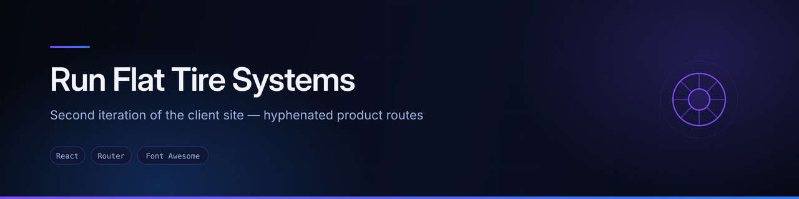
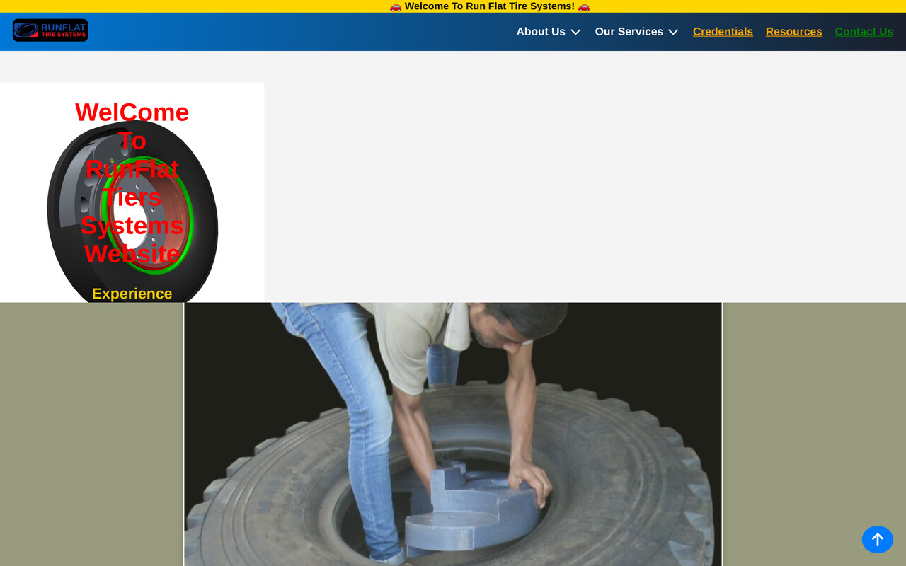

<div align="center">
  
</div>

<div align="center">


</div>

## Overview

Corporate site for **Run Flat Tire Systems** — company pages plus five product families covering run-flat inserts, bead-lock systems and wheels for military, armoured and specialist vehicles.

This is the **second of three iterations** of the same client project, and the README says so rather than presenting it as a standalone build:

| Repository | What it is |
|---|---|
| `myfirst-freelance-website` | The original build — my first freelance delivery |
| **`runflat-tiers-systems-website`** | **This one — restructured, hyphenated product routes** |
| `run-flat-systems` | The current rebuild — JSON catalogue data, per-product detail routes |

The main change at this stage was readable URLs: `/runflat-tires` and `/military-runflat-tires` instead of the original `/runflatsystems` and `/militaryrunflatsystem`.

## Preview



<sub>Screenshot captured from a local production build of this repository.</sub>

## Features

- **Fifteen routes**, all client-side
- **Company section** across six pages — company, team, news, markets, materials, strengths
- **Five product pages** — `/runflat-tires`, `/military-runflat-tires`, `/beadlock-systems`, `/heavy-duty-wheels`, `/military-wheels`
- **Credentials and resources** pages
- **Contact page**
- **Landing page** composed from stacked hero sections, services and products

## Tech stack

| Layer | Technology |
|---|---|
| Framework | React (Create React App) |
| Routing | React Router DOM — 15 routes |
| Icons | Font Awesome, React Icons |
| Styling | Hand-written CSS per component |

## Build issue: three packages are missing from package.json

**`npm install && npm run build` fails on a clean clone.** Three packages the code needs are not declared:

```bash
npm install react-refresh @fortawesome/fontawesome-svg-core react-icons
```

- `react-refresh` — required by the Create React App webpack config
- `@fortawesome/fontawesome-svg-core` — peer dependency of `@fortawesome/react-fontawesome`
- `react-icons` — imported directly by `src/Components/Products/`

Adding all three to `dependencies` is the proper fix. That is a source change, so it is documented here rather than applied.

Also worth noting: `cra-template` and `rimraf` are listed under `dependencies` where they do not belong, and `framer-motion` and `react-spring` are declared but never imported.

## Running locally

```bash
git clone https://github.com/AJAY2043/runflat-tiers-systems-website.git
cd runflat-tiers-systems-website
npm install
npm install react-refresh @fortawesome/fontawesome-svg-core react-icons
npm start
```

## Future improvements

- Fix `package.json` as described above — this is the first thing to do
- Set a real page title and favicon; `public/index.html` still says `React App`
- Carry the JSON catalogue approach from `run-flat-systems` back here, or retire this iteration in its favour
- Add a 404 route

## Author

**Ajay Krishna Reddy Bhavanam** — Melbourne, Australia
[LinkedIn](https://linkedin.com/in/ajay-krishna-reddy) · [GitHub](https://github.com/AJAY2043)
